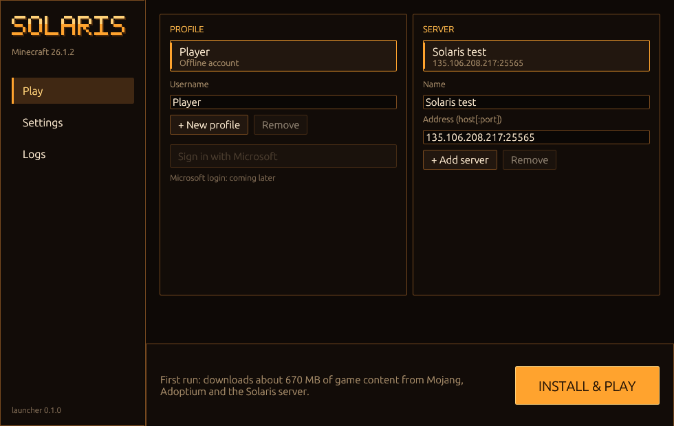
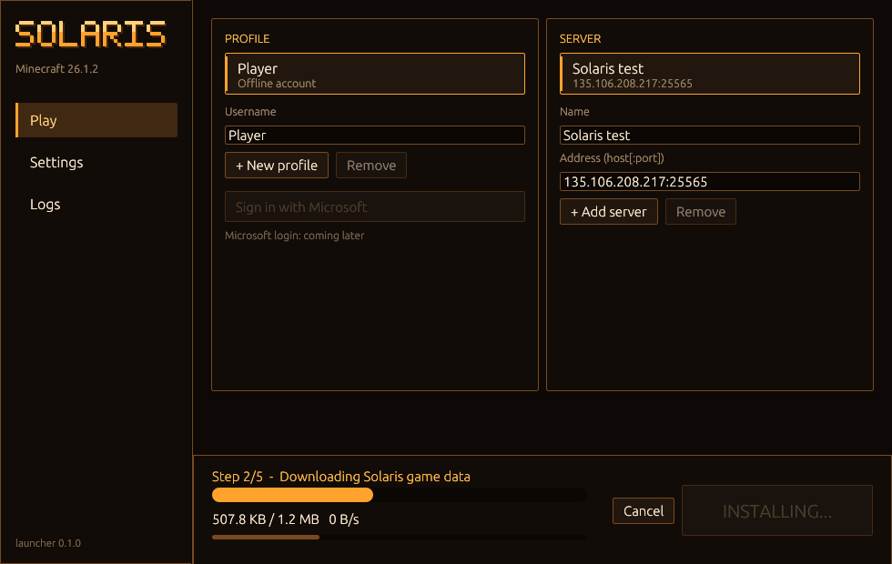
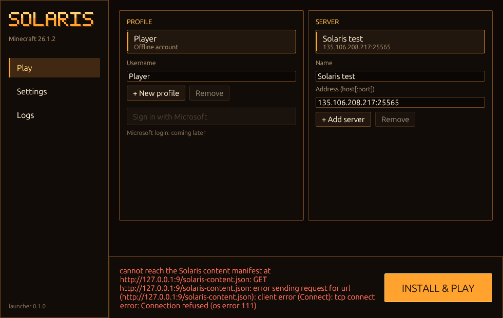
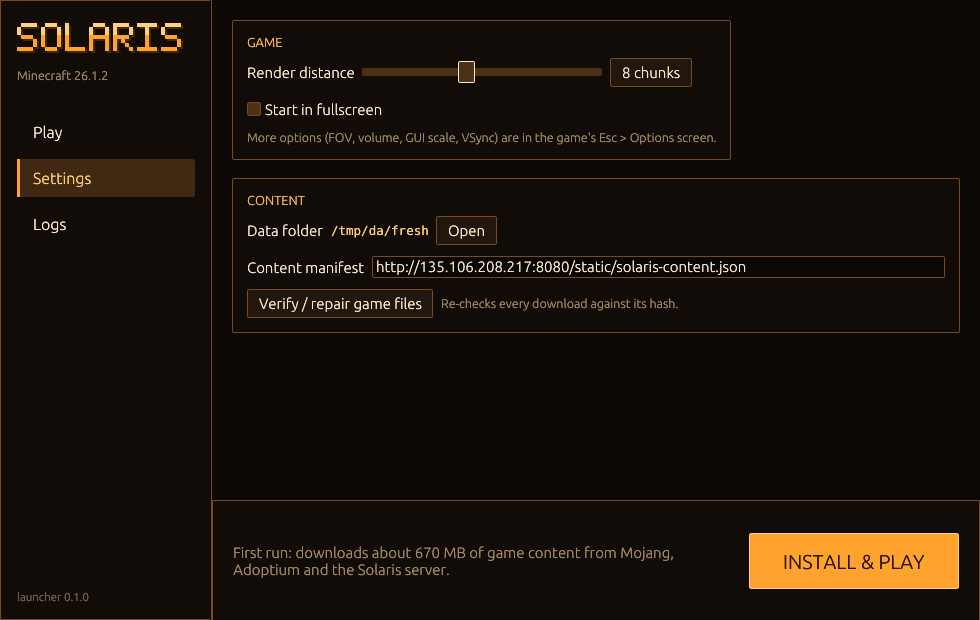

# Solaris design language

**Status:** R&D proposal, 2026-10-23. Nothing here is implemented. It is the target for the implementation slices in §11. Every mockup value is illustrative unless it cites a capture or source line.
**Authors:** DesignOpus (visual language, audit captures, icons, mockups, this consolidation) and DesignAstra (interaction/IA, accessibility, flows, cited slop research; full argument in [`2026-10-23-astra-ux-review.md`](2026-10-23-astra-ux-review.md)). The two drafts were written independently, then cross-reviewed. §12 lists where they disagreed and what we recommend.
**Covers:** the native launcher, the native client's own UI, Solaris Loader UI on Fabric, plugin-provided views, the server operator dashboard, and future Solaris web pages. **Vanilla Minecraft screens stay vanilla** (§2).

| File | What it is |
|---|---|
| [`foundations.svg`](foundations.svg) · [png](foundations.png) | Colour roles with measured contrast, type scales, grid, the notch, material, motion |
| [`components.svg`](components.svg) · [png](components.png) | Component inventory with states, launcher/web and in-game |
| [`icons.svg`](icons.svg) · [png](icons.png) | 58-icon sketch on a 16×16 pixel grid (original artwork) |
| [`mockups/launcher-play.svg`](mockups/launcher-play.svg) · [png](mockups/launcher-play.png) | Launcher, game installed, server selected |
| [`mockups/launcher-install.svg`](mockups/launcher-install.svg) · [png](mockups/launcher-install.png) | First run while installing, plus every action-bar state |
| [`mockups/client-options.svg`](mockups/client-options.svg) · [png](mockups/client-options.png) | In-game Options (Solaris-owned) at GUI scale 3 |
| [`mockups/client-monitor.svg`](mockups/client-monitor.svg) · [png](mockups/client-monitor.png) | Monitor viewing consent and owner panel, GUI scale 2 |
| [`mockups/client-plugin-view.svg`](mockups/client-plugin-view.svg) · [png](mockups/client-plugin-view.png) | A Loader schema-2 plugin view in the shared language |
| [`mockups/dashboard.svg`](mockups/dashboard.svg) · [png](mockups/dashboard.png) | Prospective operator dashboard (web) |
| [`ux-state-contract.svg`](ux-state-contract.svg) | DesignAstra's monitor permission and state sheet |
| [`audit/`](audit/) | Launcher captures from release `d90b9c2` (§3.1) |

---

## 1. Point of view

Solaris is **an instrument, not a skin.** Our UI has three jobs: get the player into the right world, say plainly what is happening, and let them change it safely. The world is the hero. When our UI is open it should feel calm, exact and slightly industrial, like a well-made tool. It should not look like a SaaS landing page, a sci-fi cockpit or a recoloured Minecraft theme.

Five principles, in priority order:

1. **Truth before polish.** Never show a state we have not observed: no fake "Offline", no percentage for an unknown total, no "Success" when work was only queued, no disabled "coming soon" button standing in for a feature. Unknown, canceled, denied, stale and failed are separate states, and each has its own words.
2. **One accent, earned.** Amber `#FFA32E` marks only four things: the primary action, keyboard focus, the selection marker, and progress fill. Together they cover at most about 5% of a screen. Surfaces are told apart by tone, not by outlines.
3. **Pixel-true.** Everything sits on whole pixels: 4 px steps in the launcher, whole GUI pixels in game. Icons are drawn on a 16×16 grid. Our one ornament is the **notch**, a single-pixel corner step that appears only on controls.
4. **Words for decisions, icons for tools.** A choice with consequences (join, grant, revoke, delete, stop) gets a verb and an object. Icon-only buttons are for a small universal tool set. We never squeeze a word into an icon-sized button.
5. **Vanilla is sacred, ours is consistent.** Vanilla screens keep vanilla sprites and layout. Every surface we own speaks one language: the launcher, our in-game screens, Loader views, the dashboard and the web.

---

## 2. Scope and the vanilla boundary

| Surface | Ours (this language applies) | Stays vanilla / not ours |
|---|---|---|
| Native launcher | Everything in the window | OS dialogs, browser/Microsoft auth |
| Native client | Options (our categories and controls); monitor picker, consent, owner panel; sharing/voice HUD chips; toasts; Loader view renderer; our error **copy** shown inside vanilla screens | Title, Multiplayer, Direct Connect, Pause, Disconnected chrome; inventory and every container; recipe book; book and quill; hotbar, hearts, hunger, XP; chat; advancements; statistics; F3 |
| Fabric Solaris Loader | Permission prompt copy; the custom view layout and copy; Solaris overlays | Minecraft widgets: use vanilla `Button`, `EditBox`, `TabNavigationBar` and list widgets as they are |
| Plugins | View titles, labels, action wording, data layout in custom views | Vanilla container chrome when a plugin uses inventory menus (for example basic-economy) |
| Server | Operator dashboard and future web pages | Prometheus/JSON payload formats, terminals, browser chrome |

**Joint recommendation:** move Title, Multiplayer, Direct Connect, Pause and Disconnected back to vanilla chrome. Today they are re-skinned in amber (§3.3). Solaris branding on Title appears only as the wordmark in the logo slot. This changes a lot of what the client looks like now, so it needs the owner's confirmation (§12, D1).

---

## 3. Audit of what ships today

Unless marked otherwise, captures are from frozen release **`d90b9c2`** (`solaris-launcher` sha256 `4800e1f2…`, `solaris-client` `2f9425ef…`). Byte-identical copies ran on a private Xvfb `:163` with `WAYLAND_DISPLAY` unset, never on the owner's desktop. Source citations use the form `d90b9c2:path:line` (`git show d90b9c2:…`), because the working tree keeps moving under other agents.

**Where the images are stored.** Launcher captures contain only our own pixels, so they live in `audit/`. Client captures contain Mojang-derived pixels (font and textures). They therefore stay as local, git-ignored evidence in `../../.analysis/design-audit/` and are linked here rather than copied.

### 3.1 Launcher

| | |
|---|---|
|  |  |
| `audit/launcher-play-first-run.png`: fresh data root | `audit/launcher-installing.png`: real first-run download, 60 s in |
|  |  |
| `audit/launcher-error-manifest.png`: unreachable manifest | `audit/launcher-settings.png` |

[`audit/launcher-logs.png`](audit/launcher-logs.png) shows the Logs tab after that failure.

| # | Problem (observed) | Why it matters | Where |
|---|---|---|---|
| L1 | Play is two edit forms: profile and server editors sit side by side, and every keystroke saves (`changed → save_config`). The selected row is drawn the same as the text field below it. | Choosing where to play and editing a bookmark are mixed together, so an accidental edit persists. The screen reads as a settings page, not a Join page. | `d90b9c2:launcher/src/ui.rs:500-599` |
| L2 | A border on everything. Sidebar, both panels, every row and every field have a 1 px amber-brown rim (`RIM` = 2.6:1 on the panel). | A box around everything is the classic generated-UI tell, and it flattens hierarchy because every container shouts at the same level. | `ui.rs:207-213, 236` |
| L3 | Two unrelated typefaces: a pixel wordmark next to egui's default proportional font (`default_fonts`). Section headings are ALL-CAPS 13 px in amber. Primary buttons are ALL-CAPS: "INSTALL & PLAY". | The default font is egui's equivalent of "nobody chose the type". ALL-CAPS amber headings compete with the one real action. | `ui.rs:164-168, 222, 402-405` |
| L4 | Default egui widgets left unthemed: a grey/white slider knob and the stock checkbox. | Off-palette default widgets are the launcher's version of "shadcn left at defaults". | `audit/launcher-settings.png` |
| L5 | A raw `anyhow` error chain fills the action region: the URL repeated three times plus `os error 111`, in red, with "INSTALL & PLAY" still next to it as if nothing happened. | It doesn't say what failed or what to do. The red text and the primary button fight each other. | `audit/launcher-error-manifest.png`, `ui.rs:307-315` |
| L6 | During install the primary slot becomes a disabled "INSTALLING…" button. Two bars have no labels (stage and "overall"). After 60 s it showed `507.8 KB / 1.2 MB · 0 B/s`, with nothing telling the player the transfer had stalled. | A disabled button looks like a dead control. A stall looks the same as progress. | `audit/launcher-installing.png`, `ui.rs:401-460` |
| L7 | Cancel is shown as an error: user cancellation becomes the string `"Cancelled"`, gets logged with `ERROR` and is displayed in red. | It punishes the player for a successful choice. | `ui.rs:307-315, 382` |
| L8 | "Stop" calls `child.kill()`. | The label hides what it does: force-killing can lose unsaved progress. | `ui.rs:414-418` |
| L9 | "Sign in with Microsoft" is a disabled full-width button with "coming later" under it. | Promoting something that can't be done. | `ui.rs:545-550` |
| L10 | Settings duplicates game settings (render distance), and the next line says the other options are in game. The raw content-manifest URL is an editable field next to "Start in fullscreen". | Two sources of truth, and a trust-critical developer option sits next to everyday ones. | `ui.rs:603-651` |
| L11 | Layout: a 210 px sidebar for three items, panels with min-height 380 that are half empty, and a 120 px action bar for one button. | Wasted width where the server list needs it, and nothing guides the eye. | first-run capture |
| L12 | Launcher and client keep **separate server lists**: the launcher uses `<root>/launcher.json`, the client uses `servers.json` beside its settings. The client's Multiplayer screen said "No saved servers" while the launcher listed "Solaris test". The two captures used different data roots; the split itself is proven by source. | The player maintains two lists that diverge. | `d90b9c2:launcher/src/config.rs:1`, `d90b9c2:launcher/src/paths.rs:73-74`, `d90b9c2:src/ui/menus.rs:16-21` |

### 3.2 Native client: our own screens

Local captures are in `../../.analysis/design-audit/`: `client-options-{video,controls,audio,interface}.png`, `client-title.png`, `client-multiplayer.png`, `client-direct-connect.png`, `client-after-refused.png`, `client-pause.png`, `client-hud.png`, `client-inventory.png`. Monitor captures are older (see the provenance note in C6).

| # | Problem (observed) | Where |
|---|---|---|
| C1 | **A rim and glow on every control.** Every option row is its own rim-outlined box. Hover adds a two-ring amber glow (`pixel_glow`). Panels get an amber top "sheen" at 18%. The shell backdrop is a 40-band warm gradient plus vignette. | `d90b9c2:src/ui/theme.rs:73-85,112,135,163`; `widgets.rs:189,231-258` |
| C2 | **Hardcoded colours bypass the theme**: `0xffffd98a`, `0xffffe2a8`, `0xffffc063` are scattered through the widget painter. | `d90b9c2:src/ui/widgets.rs:80,82,110,135,157` |
| C3 | Switches repeat their state as text ("On" + switch). Narrator is a click-to-cycle row with no control. Values are dim and far from their slider. | `client-options-interface.png` |
| C4 | Categories are Video, Controls, Audio, Interface. "Desktop computer" (a privacy-relevant capture feature) sits under **Controls**. Accessibility settings are mixed into Interface. | `d90b9c2:src/ui/options.rs:30,93` |
| C5 | The **owner's example**: words crammed into tiny buttons where vanilla uses icons. Recipe-book category tabs are 28×20 GUI px buttons labelled with raw ids (`crafting_building_blocks`, "Search"). The recipe toggle is a 50×20 "Recipes" text button. Book page turns are `<` and `>` text buttons. (The working tree has since changed these lines. The citation is to the release.) | `d90b9c2:src/ui/catalogue.rs:138-150`; `d90b9c2:src/ui/screens.rs:561-567, 933-936` |
| C6 | Monitor dialogs are one generic list for every purpose: "Your monitor" mixes Control / Change window / Stop sharing / Done in a single column, with a fixed "Up/Down: select Enter: confirm Esc: cancel" string. The picker shows raw ids ("Launch app: gnome-text-editor") and shouting copy ("Choose a NEW window…"). Those captures (from the nested-compositor branch, `2e1c03e`) also show **glyph bleed**: stray overline marks above `o` and `w`. [INFERENCE] atlas sampling or row-offset bug, not yet verified on `d90b9c2`. | `d90b9c2:src/computer/native.rs:55-66`; `src/ui/desktop.rs:69`; `src/computer/wayland.rs:33`; local `client-monitor-*-nested.png` |
| C7 | Consent copy is good in substance ("Pictures only, while looking. No remote input." with button "Allow viewing all my open screens"). It is presented in the same list styling as everything else, and focus safety is not visible. | `d90b9c2:src/computer/native/sharing.rs:19-26` |
| C8 | Error copy: a refused connect shows the title **"Connection Lost"** (nothing was ever connected) and the raw body `Connection refused (os error 111)`, with only "Back to Title Screen". | `client-after-refused.png`; `d90b9c2:src/ui/menus.rs:362` |
| C9 | Title and pause: a custom 2× pixel logo plus "Minecraft 26.1.2 · Native client", "Independent client · Offline test profile", and the pause headline "Game menu" at 2×. Each one is reasonable. Together they make the vanilla shell feel like a theme. | `d90b9c2:src/ui/menus.rs:137,174`; `screens.rs:113` |

### 3.3 Vanilla-boundary violations (observed on `d90b9c2`)

* **Inventory and containers re-skinned**: the survival inventory draws a brown/amber themed panel with an amber "Crafting" title instead of the vanilla GUI sprite (`client-inventory.png`).
* **Hotbar re-skinned**: a translucent themed panel with an amber two-ring selection frame (`d90b9c2:src/ui/widgets.rs:167-176`, `client-hud.png`).
* Title, Multiplayer, Direct Connect, Pause and Disconnected all use the amber shell theme (C9).
* The recipe book and book screens replace vanilla sprites with text buttons (C5).

### 3.4 Fabric Solaris Loader and plugin views (source audit, DesignAstra)

| # | Problem | Where |
|---|---|---|
| F1 | The permission prompt joins raw wire permission names into one sentence with generic Allow/Deny. Denying disconnects, and the prompt doesn't say so. | `../solaris-loader/loader-fabric/.../SolarisFabricLoader.java:357-376`, README:70-79 |
| F2 | The selected tab is drawn as `"[Label]"` in brackets. Debug-looking lines such as `reason: …` and `Select: <actionId>` (a raw id) reach players. | `LoaderViewScreen.java:203-206, 232-234, 336-337` |
| F3 | Two different paginators on one screen: "Page 1 of 3" for model pages and "2 / 4" for layout overflow. | `LoaderViewScreen.java:138-167, 203-206` |
| F4 | Tables are space-padded strings in a proportional font, so columns don't line up. Resource panels become lines like "Label entry: value". | `LoaderViewScreen.java:308-320, 283-288` |
| F5 | A model refresh clears drafts, the selected tab and the page. The terminal snaps to newest output while the player is reading. | `LoaderViewScreen.java:108-118`; `ComputerScreen.java:30-35` |
| F6 | Enum selects are click-to-cycle buttons ("Label: value"). | `LoaderViewScreen.java:378-389` |

Plugins (`../solaris-default-plugins`): the current shop uses vanilla container chrome, so it keeps that chrome and only its item names and lore copy change. Towns is command/chat based. Online-roster and land-claims are legacy references and must not be presented as current GUIs.

### 3.5 Server dashboard and web

`mc-edge` serves **JSON and Prometheus only** (`/stats`, `/tps`, `/profile`, `/load-metrics`, `/metrics`; `../solaris/crates/mc-edge/src/dashboard.rs:1-25`). A search of tracked files (`*.html`, `*.css`, `*.tsx`, `*.vue`, …) in the four repositories found no standalone web pages, and the audited dashboard exposes data endpoints rather than a rendered page. The dashboard mockup (§10.6) is therefore prospective. Any future site follows the same language and must not invent counters, testimonials or claims.

### 3.6 Why it reads as "neural slop"

There is no single bad colour. Several unexamined defaults stack up: everything boxed (L2, C1); glow and gradient as identity (C1); two default fonts plus ALL-CAPS (L3); stock widgets (L4); one generic list used for every decision (C6); raw system strings shown as UI copy (L5, C6, C8, F2); dead "coming later" controls (L9); and words where icons belong (C5). The research below names exactly these patterns.

---

## 4. Anti-patterns: what "AI slop / vibe-coded UI" looks like, and what we never ship

**Research** (searched 2026-10-23: "vibe coded UI", "AI slop UI", "generic AI design", "gui slop". The last phrase returns nothing substantive and is not a real category.)

* NN/g, Kate Moran, [GenUI vs. Vibe Coding: Who's Designing?](https://www.nngroup.com/articles/genui-vs-vibe/) (2026-03-27). It compares a vague-prompt trip planner, [screenshot](https://media.nngroup.com/media/editor/2026/03/18/vague-vibe-coding-trip-planner.jpg) (three equal cards, pictograms, pills, whitespace), with a specified one, [screenshot](https://media.nngroup.com/media/editor/2026/03/18/specific-vibe-coding-trip-planner.jpg) (map, timeline and detail each have a job). Without design decisions the output defaults to generic structure. It is not a usability study.
* Sara Johanna Elin, [Why Vibe Coded Interfaces All Look the Same](https://www.sarajohannaelin.studio/en/vibe-coding-design-quality/) (2026-06-30), which includes a [grid of nine AI-generated SaaS pages](https://www-static.sarajohannaelin.studio/wp-content/uploads/2026/06/ai-1024x779.webp): "same Inter font, same Lucide icons, same blue-to-purple gradient, same rounded corners on everything". Her conclusion is that this is a missing-brief problem, not a tool problem.
* [unslop-ui "tells" catalogue](https://github.com/iamneilroberts/claude-skills/blob/main/skills/unslop-ui/references/tells.md). It ranks tells by how often they appear in about 3,000 comments from "why do AI sites look the same" threads: default shadcn/Tailwind look, AI purple, gradients and gradient text, unmotivated animation, a large radius on everything, **dark mode plus unprompted neon glow**, emoji as icons, Inter/Geist, hero + three cards + CTA. It also lists patterns the data cleared (bento grids, dark mode itself), which keeps us from over-correcting.
* InterfaceKit, [What is AI slop in UI design?](https://blog.interfacekit.io/what-is-ai-slop-ui-design) and [What makes a website look AI-generated?](https://blog.interfacekit.io/what-makes-a-website-look-ai-generated), plus Designpixil, [AI Slop](https://designpixil.com/blog/ai-slop-design). These are commercial sources but useful checklists: the substitution test, the decoration-off test, the "uncomfortable state" test, and product-specific language.

Third-party images are linked, not copied. A palette, a font or a component library alone doesn't prove anything was AI-made. "Slop" here means **shipping unexamined defaults**.

**Never ship** (each line traces to an audit item):

| Never | Why it fails for Solaris | Instead |
|---|---|---|
| Words crammed into icon-sized or round buttons (C5) | Neither readable text nor a recognisable icon, and it breaks the moment it's translated | Vanilla sprites in vanilla screens; in ours, an authored 16 px icon plus a tooltip on hover and focus; a full text button for decisions |
| A border or rim around every container (L2, C1) | Everything is equally loud, so there is no hierarchy | Tone steps (ink0→ink3), hairline dividers, whitespace |
| Glow, sheen, gradient-band backdrops, vignettes (C1) | The "dark mode + neon glow" tell, and it reduces legibility over the world | Opaque-enough surfaces and a flat scrim. Motion only for state |
| Amber (or any accent) as the identity of every element | The accent stops meaning "act here" | Amber only for primary action, focus, selection marker and progress |
| Default framework widgets/fonts left as-is (L3, L4) | "Nobody chose this" | Tokenised widgets, Plex type, the notch |
| ALL-CAPS buttons and headings (L3) | Shouting, poorer word shapes, and it fights the primary action | Sentence case. Weight and position carry hierarchy |
| Raw error chains, `os error 111`, raw ids (`Select: claim_plot`) in player copy (L5, C8, F2) | It hides what happened and what to do next | What happened → what it means → what to do, with raw text under Details |
| Disabled "coming soon" controls on the main path (L9) | It advertises a dead end | One plain line describing the boundary, or nothing |
| A disabled button standing in for progress (L6) | A dead control and no information | A status line with named stages and real numbers |
| Canceled, denied or unknown shown as red errors (L7) | It misreports what the player did | Neutral wording for neutral outcomes |
| Fake metrics, decorative sparklines, invented "Online" | Operators and players act on false state | Real source, unit, window, last-sample time; "Not checked yet" |
| Hero + three feature cards + gradient headline in the launcher | Marketing gets in the way of joining a server | Current destination, readiness, one Join |
| Emoji as icons; mixed icon families | Renders inconsistently and looks low effort | One 16×16 pixel-grid set |
| Icon-only grant, revoke, delete or stop | The consequence is ambiguous | Verb + object + scope, with safe initial focus |
| Status shown only by colour, sound or hover | It excludes people and fails when muted | Icon + words, readable on focus |
| Re-skinning vanilla screens wholesale (§3.3) | Breaks the owner's rule and what players already know | Vanilla stays vanilla |
| Novel asymmetric layouts just to look "not AI" | Taste theatre is as unexamined as a template | Structure that follows the task |

---

## 5. Principles in practice

* **Hierarchy comes from position, size and tone, not from boxes.** A screen has one primary action, bottom-right in the launcher and in the dialog footer in game. Secondary actions sit to its left; destructive actions are separated by space.
* **Selection and editing are separate modes.** Lists select. Forms edit, with explicit Save and Cancel. Live preferences apply immediately and say so once.
* **State is written in words.** Every status has an icon and a sentence. Colour reinforces it and never carries it alone.
* **Copy formula:** *what happened → what it means → what you can do*. Name the server, the file, the person. No "Oops", no "Something went wrong".
* **One setting, one owner.** In-game settings live in game. The launcher holds only startup and content settings, and anything that applies later is labelled "Applies next launch".
* **Privacy is always visible.** While a monitor is being shared, a chip says so, and it survives Hide HUD unless the player turns it off explicitly.

---

## 6. Foundations

Specimen: [`foundations.svg`](foundations.svg).

### 6.1 Colour tokens

All contrast ratios below are WCAG 2.x relative-luminance ratios, computed from the token values.

| Token | Hex | Role | Contrast |
|---|---|---|---|
| `ink0` | `#0F0D0B` | Window / deepest background; modal scrim at 72% | — |
| `well` | `#0B0A08` | Recessed: inputs, slider tracks, log well | — |
| `ink1` | `#181512` | Surface: panels, bars (in game at 94% alpha) | — |
| `ink2` | `#221E1A` | Raised: rows, controls at rest | — |
| `ink3` | `#2D2823` | Hover; selected row fill | — |
| `line` | `#3A332C` | Hairline dividers (decorative, not a boundary) | 1.46 on ink1 |
| `edge` | `#7A6C5E` | Control and input boundary | 3.58 ink1 · 3.26 ink2 |
| `text1` | `#F2EADF` | Primary text | 15.25 ink1 · 12.23 ink3 |
| `text2` | `#B9AD9C` | Secondary text, values | 8.24 ink1 · 6.61 ink3 |
| `text3` | `#8C8174` | Tertiary text and disabled labels on `ink0`/`ink1` only. Meaning-bearing hints on `ink2`/`ink3` use `text2` | 4.77 ink1 · 4.34 ink2 (below 4.5) |
| `amber` | `#FFA32E` | **Accent**: primary action fill, focus ring, selection bar, progress | 9.12 ink1 |
| `amberHi` / `amberLo` | `#FFC56E` / `#D9831A` | Primary hover / pressed | — |
| `onAmber` | `#1A1206` | Text on amber | 9.29 on amber · 6.36 on amberLo |
| `danger` | `#FF6E5A` | Errors, destructive text and edges | 6.61 ink1 |
| `ok` | `#93C572` | Verified, success, measured-good | 9.07 ink1 |
| `warn` | `#E8C547` | Stalled, degraded, attention | 10.83 ink1 |
| `signal` | `#7FB4E0` | Sharing, remote people, request from another player | 8.23 ink1 |

Compared with today: `TEXT_OFF #7A6650` measures 3.55:1 on the panel and `RIM #784A1F` 2.59:1. The new `edge` meets 3:1 on `ink0`–`ink2`. The new `text3` reaches 4.5:1 only on `ink0`/`ink1`, so it is restricted to those backgrounds or to decorative and disabled text; ordinary hints on raised surfaces use `text2`. Semantic colours are never used as fills behind text. They appear as a left bar, an icon, text, or (for danger) a control edge. In game, panels are `ink1` at 94% over a world scrim, so contrast must be measured on the final composited frame. In high contrast mode the panel is fully opaque.

### 6.2 Typography

**Launcher, dashboard, web:** IBM Plex Sans plus IBM Plex Mono (SIL OFL 1.1, Latin and Cyrillic). They are bundled as subset TTFs; there is no system or default font.

| Style | Size/line | Weight | Use |
|---|---|---|---|
| Wordmark | Solaris Pixel 5×7, 3–4 px cells | — | The "SOLARIS" wordmark and splash. Never headings, dialogs or consent text |
| H1 | 22/28 | SemiBold 600 | Screen or detail title ("Solaris test") |
| H2 | 16/22 | SemiBold 600 | Section ("Servers") |
| Body | 14/20 | Regular 400 | Default |
| Small | 12/16 | Regular | Meta, hints, "Applies next launch" |
| Mono | 13/18 | Regular | Addresses, paths, hashes, byte counts, logs, table numbers |

Sentence case everywhere. Tabular numerals for anything that updates. Body lines are at most 72 characters.

**In game:** the vanilla font only, so there is no second face in the world. Sizes are 1× (line 10 GUI px). 2× is allowed only for the Title logo slot. Hierarchy comes from colour (`text1/2/3`), position and spacing. No non-integer scaling and no fake bold. Mockups draw text with *Solaris Pixel*, an original 5×7 face, as a stand-in, so that no Mojang glyphs are copied.

### 6.3 Grid and spacing

* **Launcher:** 4 px base, scale 4 · 8 · 12 · 16 · 24 · 32 · 48. Window 980×620 by default, minimum 820×540. A 56 px top bar replaces the sidebar. Content gutter 24. Fluid server list plus a 320 px detail column. A 72 px action bar (status on the left, one primary on the right).
* **Control sizes:** 36 ordinary · 40–44 primary and safety · 32×32 icon buttons · 24 compact, only in dense tables with ≥8 px separation. These are effective rendered sizes at 100% OS scale.
* **In game:** GUI px, gaps 2/4/6/8. Controls 20 tall (vanilla rhythm). Option rows 18, separated by 1 px hairlines. Icons 16. Panel inner margin 8. Layouts must fit **320×240 and 427×240 GUI px** with no clipped actions. Body text wraps or scrolls; only the middle of a window title may be ellipsised.

### 6.4 Shape and material

* **The notch:** one unit cut from each corner (1 GUI px in game, 2 px in the launcher). It applies to controls only: buttons, fields, switches, chips, icon-button hover plates. Panels, bars, dialogs and rows stay square.
* **Elevation is tone.** No drop shadows, blur, glow, sheen or gradient fills, and no bordered containers. Borders exist only where they mean "this is an interactive boundary" (`edge`) or "this is the danger action" (`danger`).
* **Focus:** a 2 px amber ring with a 2 px offset that follows the notch (in game, a 1 GUI px ring offset by 1). **Selection:** a 3 px amber bar (2 GUI px in game) plus an `ink3` fill. The two never share geometry.

### 6.5 Iconography

[`icons.svg`](icons.svg) is a sketch of 58 icons: actions, status, objects, categories.

* 16×16 pixel grid, whole pixels, one ink colour plus an optional 40% "dim" ink (for example inactive signal bars). No gradients, no emoji, no third-party sets.
* The same sprite serves 1×/2×/3× in the launcher and integer GUI scale in game. One PNG atlas plus a name index ships with the launcher, the client and the Loader.
* **The icon-only tool set** (close, back, more, copy, search, settings, folder, external) always has a tooltip on hover *and* keyboard focus, plus an accessible name. Everything else shows its label.
* Status icons always pair with words: `signal-4` "Online · 42 ms", `signal-unknown` "Not checked yet", `offline` "No answer at 19:41".
* Vanilla screens keep their vanilla sprites (recipe tabs with item icons, the vanilla filter toggle, page-turn arrows). Our set never substitutes for them.

### 6.6 Motion

| Duration | Use |
|---|---|
| 0 ms | Reduced-motion mode; permission revocation; error appearance |
| 80 ms | Hover and press tint |
| 120 ms | Switch knob, tab underline, slider value |
| 160 ms | Dialog in (opacity only, no scale or slide) |
| never | Idle shimmer, breathing glow, parallax, bounce, skeleton sweeps, a looping "fake" progress sweep |

Ease-out only. Revocation and error states are never delayed by an exit animation.

### 6.7 Sound

One quiet click when an action is accepted, in the vanilla UI-click category so it obeys the volume setting. No hover sounds, no toast chimes, no branded stings. A permission request may use the vanilla UI click once, and its visual prompt is the actual cue. Every sound has a visible equivalent.

### 6.8 Voice

Plain, specific, calm. Use the verb plus its object ("Join Solaris test", "Revoke all viewers", "Force close game…"). An ellipsis means the action asks a follow-up question. Units always appear with values. Times are local, 24 h. Names come from the source (server name, player name, window title); ids appear only under Details.

---

## 7. Component inventory

Specimen: [`components.svg`](components.svg). Every component defines default, hover, keyboard focus, pressed, disabled (with a visible reason), busy, error and selected states where they apply. Hover never moves layout.

| Component | Launcher / web | In game | Rules |
|---|---|---|---|
| **Primary button** | Amber fill, `onAmber` 14–15/600, 40–44 tall, notched | Amber fill, 20 tall | At most one per decision region. Verb + object. Busy keeps its width and says what is happening |
| **Secondary button** | `ink2` + `edge` 1 px, 36 tall | `ink2` + `edge` | — |
| **Quiet button** | Text only, `ink3` on hover | — | Tertiary actions ("Add server", "Details") |
| **Danger button** | `danger` text + `danger` edge, never a red fill | Same | Confirms only when it destroys something not recoverable, and names the consequence |
| **Icon button** | 32×32, 16 px icon, `ink3` plate on hover | 20×20 | Universal tools only; tooltip on hover and focus |
| **Text field** | `well` fill, `edge` 1 px, amber ring on focus, label above, hint or error below | Vanilla `EditBox` look in vanilla screens; our field in ours | Errors appear on submit/blur and keep the input. Mono for addresses |
| **Switch** | 36×20 notched, amber track when on | 18×10 | The label describes the *on* state. No duplicate "On/Off" text |
| **Segmented control** | Up to 4 options, `ink3` + amber underline for the selected one | Same in GUI px | Replaces click-to-cycle |
| **Slider** | 4 px `well` track, amber fill, 10×20 thumb, mono value + unit to the right | 2 px track, 4×10 thumb | Arrow keys step; Home/End go to min/max; the value is always visible |
| **Stepper** | `–` value `+` in a field | Same | For counts in plugin actions |
| **List row / server card** | 60 px: icon plate, name 15/600, mono address, status icon + words; selected = bar + `ink3` | 18 px rows | The whole row is one target; overflow `⋯` is its own target; selection stays stable across refresh |
| **Table** | Header row on `ink2`, numbers right-aligned in mono, units in the header | Same structure in GUI px | Data pagination ("Results 1–4 of 11") is separate from scrolling |
| **Tabs** | Text + 3 px amber underline | Text + 2 px underline; Fabric uses vanilla `TabNavigationBar` | No `[brackets]` |
| **Progress** | Named stepper (done ✓ / current ■ / upcoming) + determinate bar only with known bytes | Same | Unknown totals get the stage name and the `busy` glyph, never a sweeping bar |
| **Notice (persistent)** | `ink2` + 3 px semantic left bar + icon + title + body + actions | Same | Stays until resolved |
| **Toast** | Bottom-left, 5 s, pauses on hover/focus | Top-right below the chips, 4 s | Only for reversible confirmations ("Server saved · Undo"). Never for decisions, errors or privacy |
| **Dialog** | Title, consequence, focused task, footer actions; scrim `ink0` 72% | Same | Traps focus and restores it to the invoker. Safe initial focus. Esc never approves |
| **HUD chip** | — | `ink0` 82% + 2 px semantic bar + icon + words, top-right safe zone | Sharing, watching, mic. Persistent while the state lasts |

---

## 8. UX flows

Full rationale is in DesignAstra's draft, §4. The rules below are binding, and they hold for both the happy and the unhappy path.

**F1 First run and download** ([`launcher-install`](mockups/launcher-install.png)).
1. Before any work starts, show version, size estimate, sources (Mojang assets, Adoptium Java, Solaris data) and the install location with "Change…". Once installing has started, the location can't be changed; the notice says "Cancel to change location".
2. The primary action captures intent: **"Install and join Solaris test"**. Selecting a server never starts network work. If the player selects a different server during the install, the captured destination is kept (or the player is asked); the queued action is never silently reinterpreted.
3. Named stages: Check · Java · Game data · Assets · Verify. Bytes and speed appear only when the total is known. Measured inactivity is stated in words (warn colour): "No data received for 30 s. Download is still pending." The 30 s threshold is a proposed UI policy, not observed behaviour. Say "retrying" only if the installer actually reports a retry; never infer a cause.
4. **Cancel install** → "Canceling…" → a neutral "Installation stopped. You can try installing again." Never auto-join after cancel. Steps that already ran may have written files, so retention or "nothing changed" is claimed only when the installer reports it.
5. Failure stays in the action bar: a one-line summary, **Retry** as primary, and **Details** with the raw chain (selectable, copyable, secrets redacted). Generic copy is "Installation did not finish. See details or retry." Say "Nothing new was installed" only when the failure provably happened before any write (for example, the manifest fetch). For an unreachable manifest, the remedy points to **Settings › Advanced**.
6. "Starting game" is not "Joined". A running game shows "Solaris is running", and the only control is **Force close game…** (with a confirmation naming the unsaved-progress risk) until graceful quit exists.
7. Closing the launcher during install asks "Keep downloading / Cancel and close".

**F2 Server selection and connection** ([`launcher-play`](mockups/launcher-play.png)).
* Click or arrows select; Enter or double-click joins. Focus and selection look different.
* Add and edit happen in a small form with **Save server / Cancel**. Invalid keystrokes are not saved. Removing a server deletes a bookmark only and offers **Undo**, not "Are you sure?".
* Status is shown only from a real probe: "Online · 42 ms", "Not checked yet", "No answer at 19:41". A version mismatch names both versions and doesn't offer a Join that can't work.
* One server list shared by the launcher and the client (fixes L12).
* Connecting can be cancelled, and a success that arrives after cancel must not open a session. Timeout or refusal returns to the same selection; retry is always an explicit choice, never an automatic loop.
* Connection failure in game: Disconnected keeps vanilla chrome but our copy. Title "Couldn't connect" (not "Connection Lost" when nothing was connected), body "Solaris test (135.106.208.217) refused the connection. The server may be offline.", actions **Retry** and **Back to servers**. The raw OS error goes under Details.

**F3 Settings** ([`client-options`](mockups/client-options.png)).
* Categories: Video · Controls · Audio · Interface · **Accessibility** · **Privacy** (desktop capture, voice and monitor permissions live here).
* Ordinary preferences apply immediately. The footer explains the focused row and when it applies, once. **Reset [category]** is scoped and its label names the category. **Done** is always in the same place.
* Display changes that can hide the UI use a timed Keep/Revert prompt with focus on Revert. Failed applies restore the authoritative value with a reason.
* The launcher keeps only startup settings (fullscreen at start, data folder). The content manifest moves under an **Advanced** disclosure with a trust note.

**F4 Monitor capture and viewing consent** ([`client-monitor`](mockups/client-monitor.png), [`ux-state-contract.svg`](ux-state-contract.svg)).
* There are three separate permissions: local OS capture, local control of your own source, and another player's viewing. Never merge them.
* Picker: the window titles the OS gives us, the monitor size in words ("3 × 2 monitor"), and the OS dialog route labelled plainly ("Choose with the system picker…"). No app ids, no capital-letter shouting.
* Consent: who is asking (with "offline name, not verified" where that's true), what they get (**all open screens**, which is the real grant today, `sharing.rs:19-26`), what they don't get (no keyboard or mouse), and that it can be revoked. The buttons carry equal visual weight and **focus starts on Deny**. Esc denies; nothing auto-accepts. The Allow label states the scope: "Allow viewing all open screens".
* Until a narrower per-window grant is implemented end to end, no mockup or copy may imply one.
* Lifecycle safety: a changed source, identity or scope needs an explicit permission policy and never silently inherits an earlier grant. Focus loss releases held input. When capture fails, the picture is marked ended or stale, never left as a frozen image that looks live. Local "stopped sending" is reported straight away, separately from remote completion, which is not claimed until it is observed.

**F5 Monitor owner panel.** Three groups. **Source**: window title, since when, Change window. **Your control**: status, Control window, Esc releases it. **Viewers · N allowed**: one row per person ("Allowed at 19:43"; "Watching now" only if it is actually observed) with **Revoke**. Footer: **Revoke all viewers** (capture continues), **Close capture** (danger; ends the picture for everyone), and **Done**. Key hints come from live bindings. The HUD privacy chip stays visible for as long as a capture exists. It reads "Capturing · private" (neutral) while nobody is allowed, which includes while a request is still waiting for an answer, and "Sharing · N allowed" (signal blue) once at least one viewer is allowed.

**F6 Addon permission, plugin view action, transaction** ([`client-plugin-view`](mockups/client-plugin-view.png)).
* Loader permission prompt: server identity → human-readable effects → download size → **Allow content and join / Decline and disconnect**. Raw permission names go under Details.
* View header: title, then "plugin <id> · <server>". Real tabs, aligned tables, one labelled pager. On refresh, only *compatible* UI-local state survives (tab, page, selection and drafts matched by stable field identity). A field whose meaning changed is visibly invalidated, never silently reused, and an old action is never replayed.
* Actions: verb + count ("Bake 4 bread"). States go Pending → server-confirmed applied or refused. A disabled action shows its deny reason as visible text. An old action is never replayed against a new target.

**F7 Errors everywhere.** *What happened → what it means → what you can do*, then optional Details. Errors persist until resolved; success may be transient. Canceled, denied, unavailable, stale and failed are distinct. Examples:

| Situation | Copy | Actions |
|---|---|---|
| Content manifest unreachable (failure before any write) | "Could not reach the Solaris content server. Nothing new was installed." | Retry · Details · Settings › Advanced |
| Install failed mid-way | "Installation did not finish. See details or retry." | Retry · Details |
| Disk full | "Not enough space to install game files (needs 670 MB, 210 MB free)." Numbers only if measured | Change location · Details |
| Version mismatch | "Solaris test needs Minecraft 26.1.1; you have 26.1.2." | Back to servers |
| Viewing denied | "Alex didn't allow viewing." Neutral, not red | Back |
| Capture ended by the OS | "Window capture ended. Viewers no longer get new pictures." | Choose window · Dismiss |
| Stale plugin action (explicit refusal) | "This view changed before the action could be applied." | Refresh |
| Plugin action, outcome unknown | "We couldn't confirm whether this was applied." Labelled unknown; no retry is implied to be safe | Refresh · Details |
| Dashboard stream lost | "Updates disconnected · last sample 19:44:02." The chart keeps its data and marks the gap | — |

---

## 9. Accessibility and localisation targets

These are release gates, not claims that we meet them today.

* **Keyboard:** every action is reachable. Tab/Shift+Tab moves between groups; arrows move inside lists, tabs and segmented controls; Enter/Space activate; Esc cancels and never approves. Focus is restored after a dialog closes, after a list deletion and after an async refresh. Held input is released on focus loss.
* **Targets:** 36–40 px ordinary, 40–44 px safety, 32×32 icon buttons; 24 px only in dense tables with separation. In game, measure the *effective* size at GUI scales 2 and 3. WCAG 2.2's 24×24 is a floor, not the goal.
* **Contrast:** ≥4.5:1 for text, ≥3:1 for control boundaries and focus (§6.1 values), measured over the final composited frame in game. High contrast mode makes panels opaque and swaps `text2` for `text1` in meaning-bearing places.
* **Semantics and narration:** name, role, value, state and disabled reason are exposed through the real accessibility and Narrator path. Announcements: on modal entry, on deliberate value changes, and at progress milestones (not every byte).
* **Text:** test Russian and German lengths, CJK, mixed direction and IME. Consent and destructive labels wrap and are never truncated. Paths and addresses truncate in the middle only when the full value can be copied.
* **Scale:** launcher at 820×540, 980×620, 1280×720 and 1920×1080, at 100/150/200% OS scale. In game at 320×240 and 427×240 GUI px and up.
* **Motion and sound:** reduced motion means 0 ms everywhere. No information is carried by sound alone.

---

## 10. Mockups

All are original SVG artwork with PNG previews. The world backdrop in the in-game mockups is flat placeholder art. Values are illustrative.

1. **Launcher · Play** ([svg](mockups/launcher-play.svg)): top bar with wordmark, tabs and profile chip; server list (select only) beside a detail panel (version match, server content, who you play as); honest status per row; a single **Join Solaris test**.
2. **Launcher · First run / states** ([svg](mockups/launcher-install.svg)): installing while the list stays usable, plus the six action-bar states in the same 72 px slot: first run, downloading, stalled, failed, canceled, running.
3. **In game · Options** ([svg](mockups/client-options.svg)): category list with icons, including Accessibility and Privacy; rows without boxes; value next to its control; segmented choice; focus ring vs selection bar; explanatory footer; fixed Done.
4. **In game · Monitor** ([svg](mockups/client-monitor.svg)): consent with the scope in the button and focus on Deny; owner panel grouped as Source / Your control / Viewers; persistent sharing chip.
5. **In game · Plugin view** ([svg](mockups/client-plugin-view.svg)): Loader schema-2 widgets (tabs, resource summary, aligned paged table, stepper, primary action, disabled action with a visible reason) and provenance in the header.
6. **Server · Operator dashboard** ([svg](mockups/dashboard.svg)): readout strip instead of cards; a tick-time chart with p50/p95/max, the 50 ms budget, an honest data gap and an event marker; a phase table with units; plugin counters labelled "since start"; a recent-events list with source fields.

---

## 11. Implementation plan in slices

Each slice is independently shippable and has its own captures as evidence (same Xvfb method as §3). Code changes are outside this deliverable. Order: **S0 → (S1 ∥ S2 ∥ S3) → S4 → S5 → S6**, with S7 gating every slice.

| Slice | Scope (owning files) | Acceptance (observable) |
|---|---|---|
| **S0 Tokens, fonts, icons** | One no-dependency token module, `src/ui/tokens.rs`, also included by the launcher with `#[path]` (no new crate). Plex Sans/Mono subset TTFs plus the OFL text in `launcher/assets/`. Icon atlas `assets/ui/icons.png` with a name index, built from `icons.svg`. A CSS custom-properties file for the dashboard/web, generated from the same values. | Launcher and client compile against the same token names. A unit test checks every token's contrast against the §6.1 table. The atlas loads in the launcher (egui texture) and the client GUI atlas. No visual change yet |
| **S1 Launcher** | `launcher/src/ui.rs`: top bar, select-only list + detail, Save/Cancel edit form, a single action bar with the six states, error summaries mapped from `net`/`bootstrap` errors (raw chain under Details), neutral cancel, **Force close game…** with confirmation, Settings regrouped (Startup · Content & storage · Advanced), the Microsoft placeholder removed, Logs renamed **Diagnostics** with Copy summary. Merge the server list with the client's `servers.json` (one file, one owner) | Captures match `launcher-play` and `launcher-install` for: fresh, installing, stalled (fault-injected slow server), unreachable manifest, cancel, running, child crash. Keyboard-only join works. Layout holds at 820×540 and 200% scale |
| **S2 Client theme and Options** | `src/ui/theme.rs`, `widgets.rs`, `options.rs`: remove `pixel_glow`, the sheen and the banded backdrop/vignette; tokens replace the hardcoded ARGB; rows with hairlines; switch without duplicate text; segmented control (Narrator, Shaders); focus ring separate from selection; Accessibility and Privacy categories ("Desktop computer" moves to Privacy); footer with a scoped Reset | `client-options-*` re-captured at GUI scales 2 and 3, 320×240 and 427×240. Semantic-tree tests for new control roles. Reduced motion means no animation. No amber outside the four roles |
| **S3 Vanilla boundary** | Inventory/containers and hotbar back to vanilla GUI sprites from the installed resources; recipe book with vanilla tab sprites and item icons and the vanilla filter toggle; book page-turn sprites; Title/Multiplayer/Direct Connect/Pause/Disconnected on vanilla chrome (wordmark in the Title logo slot only); our copy on Disconnected (F2) | Side-by-side captures against official vanilla 26.1.2 for the inventory, crafting table with recipe book open, hotbar, book and pause. No text-in-tab buttons remain (`catalogue.rs`, `screens.rs`). A refused connect shows "Couldn't connect" + Retry |
| **S4 Monitor privacy surfaces** | `src/ui/desktop.rs`, `src/computer/native.rs`, `native/sharing.rs`, `wayland.rs` copy: consent dialog (equal-weight buttons, focus on Deny), owner panel groups, picker copy without app ids, the HUD sharing chip, bindings-driven hints; fix the glyph bleed | Grant, deny, Esc, revoke one, revoke all, close capture, source change and disconnect all have captures plus server-observed effects. The chip survives Hide HUD. The 320×240 layout keeps every action reachable |
| **S5 Loader and plugin views** | `../solaris-loader` `LoaderViewScreen`/`SolarisFabricLoader` (vanilla `TabNavigationBar`, a list widget for tables, a single labelled pager, deny reasons visible, no raw ids, permission prompt copy and Details) and the native renderer `src/ui/loader.rs` with the same structure | Each schema-2 widget is captured on both Fabric and native. A refresh while typing keeps a *compatible* draft (same stable field identity), and a refresh that changes the field's meaning visibly invalidates it. Both cases are tested. A stale action is refused visibly and an unknown outcome is labelled unknown. Long permission lists wrap |
| **S6 Dashboard (prospective)** | `../solaris/crates/mc-edge`: a single static read-only HTML page at `GET /` using the token CSS, reading the existing `/stats` and `/load-metrics`; no controls without real actions | Stream-loss and overrun show gaps, not zeros. Every number shows its unit and source. Keyboard navigable. Reflows at 1024 px |
| **S7 Accessibility and localisation gate** | Cross-cutting checks from §9 on every slice | A Narrator pass, a keyboard-only pass, Russian and German strings, contrast measured on captures |

Highest value first: **S3 + S2** answer the owner's direct complaint (text-in-buttons, re-skinned vanilla, glow and rims). **S1** fixes the first impression. **S4** is privacy-critical.

---

## 12. Cross-review: disagreements and resolutions

| # | Topic | DesignOpus draft | DesignAstra draft | Resolution |
|---|---|---|---|---|
| D1 | Shell screens (Title, Multiplayer, Pause, Disconnected) | Revert to vanilla chrome, Solaris wordmark only in the logo slot | Don't re-organise vanilla pages to impose brand | **Joint recommendation: vanilla chrome + our copy.** Needs the owner's confirmation because it removes much of today's amber shell |
| D2 | Compact control size | 24 px compact allowed | 24 is the WCAG floor, not a target | **Astra's position:** 32/36/40–44; 24 only in dense tables with separation |
| D3 | Pixel face for headings | Solaris Pixel for wordmark and H1 | Hurts reading clarity; never in dialogs | **Astra's position:** Plex SemiBold headings; pixel face only for the wordmark and splash |
| D4 | Focus vs selection | Both amber | Amber is OK only with distinct geometry | **Agreed:** 2 px offset ring vs 3 px bar + fill |
| D5 | Sharing colour | Red "LIVE" dot | Red conflicts with danger; don't claim live watching | **Astra's position:** signal blue, broadcast icon, "Sharing · N allowed"; "Watching now" only when observed |
| D6 | Launcher render distance | Remove (one owner, in game) | One owner for each setting; if it is exposed in the launcher at all, label it "Applies next launch" | **Recommend remove** (compatible with both positions); if the owner wants it kept, label it. Low stakes |
| D7 | Icons vs labels | Icon set for every repeated tool | Reject "icons everywhere" | **Agreed:** icon-only for the universal tool set; words for decisions; vanilla sprites in vanilla screens |
| D8 | Consent button emphasis | Equal weight, neither amber | Safe initial focus on Deny | **Agreed and combined** |
| D9 | Narrow per-window grants | Mockup started as one window | Must match the real "all open screens" grant | **Astra's position:** copy and mockups state all open screens; narrowing is a separate security slice |

Open questions for the owner: D1 (vanilla shell chrome), and whether the operator dashboard (S6) is wanted at all now that `/metrics` feeds Prometheus/Grafana.

**Review record.** DesignAstra reviewed this consolidated document read-only, together with the six rendered mockups, against source and document evidence. That review raised 11 line-level corrections, all applied here and in the SVG/PNG files: honest stall/failure/cancel copy, the connection-cancel contract, monitor lifecycle safety, compatible-only refresh retention, stale vs unknown action outcomes, `text3` restricted to `ink0`/`ink1`, the narrowed web-surface claim, D6 attribution, install-location and destination capture, "Remove" without confirmation, and a neutral "Capturing · private" chip while a request is pending. DesignAstra confirmed that no review blocker remains. The review covers documents and rendered mockups only; it is not runtime-behaviour or accessibility acceptance.

---

## 13. Provenance and reproduction

* **Captures.** Release `d90b9c2` binaries were copied byte-identically (hashes match `receipt.yaml`) into a scratch directory on the games disk, which was deleted after the run along with every temporary data root. They ran on private Xvfb `:163` with `WAYLAND_DISPLAY` unset. Launcher states came from `--tab`, from `--manifest http://127.0.0.1:9/…` (the error), and from a real first-run download that was killed after the capture. Client states were driven through the client's MCP automation (`minecraft_click_screen_button`, `minecraft_open_pause_menu`, `minecraft_open_inventory`) after X11 focus was acquired. One short join to the test server (`135.106.208.217:25565`, username `DesignAudit`) was made for the HUD, pause and inventory captures, then disconnected. The monitor captures are earlier agents' receipts from the nested-compositor branch and are labelled as such.
* **Sources.** All client citations are pinned to `d90b9c2`. Loader and plugin citations come from the read-only `../solaris-loader` and `../solaris-default-plugins` working trees as of 2026-10-23.
* **Artwork.** All SVGs are original. Text uses IBM Plex (loaded from jsDelivr fontsource when viewed in a browser, with a system sans fallback otherwise) and *Solaris Pixel*, an original 5×7 face. The SVGs are the source of truth and can be edited by hand. They were drawn by throwaway Python generators kept outside the repository in `/run/media/kaiserroman/games/solaris-work/design-audit/gen/`; Main may delete that directory. PNG previews were rendered with headless Chromium.
* **No code was changed.** No build was run. This document makes no compatibility or acceptance claim.
